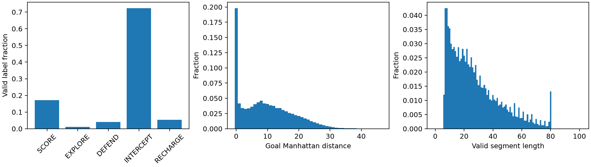
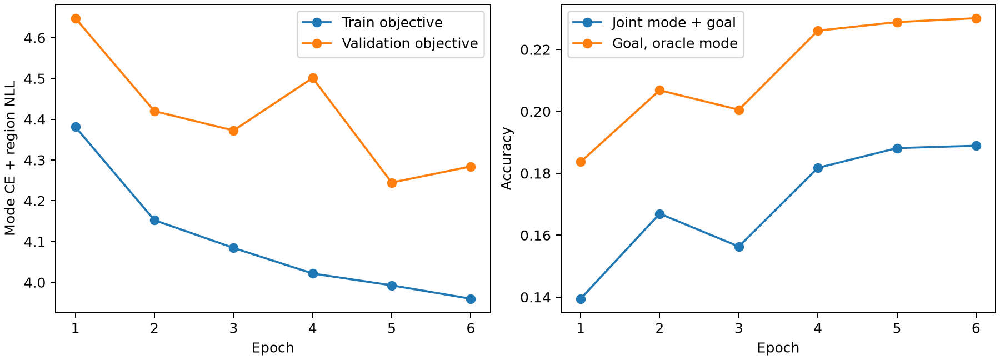
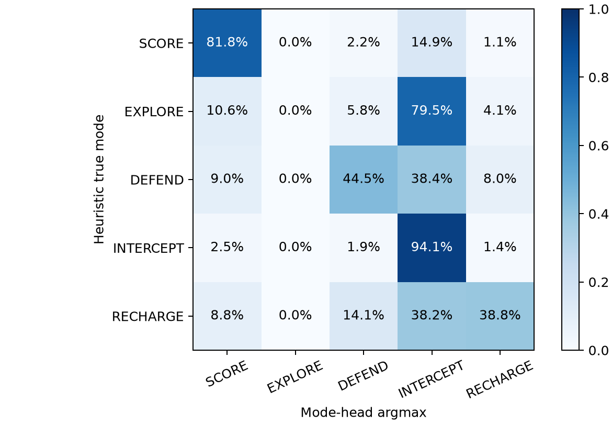
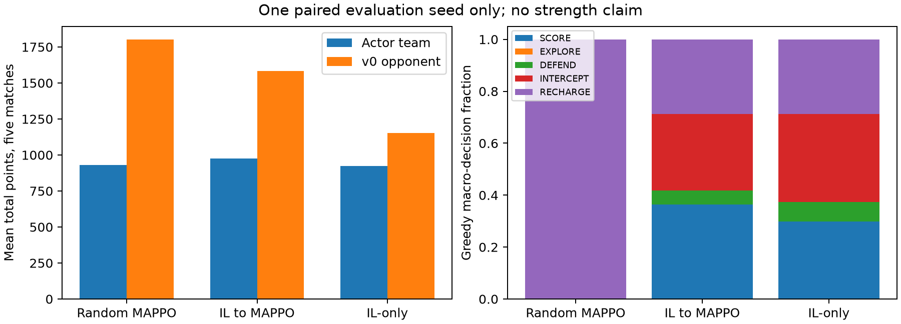

# Lux AI S3：长期 Goal IL → Goal-Level Semi-MDP MAPPO

日期：2026-10-16。代码基点 `5199df6bffd017f44c899919bb4ce766186ae11f`，官方环境 `c6d1e665d12a467b299fb586b3f876e47847746b`。新增源码及未提交状态均已记录；V2 和 vendor 未改动。最终 50-seed 留出集未使用。

## 实验假设与结论边界

假设：事件片段提取的模式与终点，比 12-step waypoint 更适合持续执行和 IL→MAPPO 初始化。本次建立并实际运行了完整链路；当前证据**不足以确认该假设**。

新目标分布比旧版尖锐，但两者使用不同录像集合、目标定义和样本量，不能把数值变化归因于标签或架构。EXPLORE 的验证召回为零；发现 5,750 个有效标签的攻击锚点来自不合法 SAP 尝试。三组在线完整对局胜率均为 0/2，IL→MAPPO 没有显示相对于 IL-only 的可靠优势。按照任务第 41 条，本轮停留在验证实现和暴露问题的小预算实验，没有扩展为大规模 RL。

## A. 数据与防穿越边界

旧 NPZ 保留位置、存活、动作、时间、分数和单位槽位；缺少精确逐单位能量与公开物理参数。旧 400 场原始 JSON 已清理，幸存 725 场与旧集合交集为零。因此重新从本地可用的 top25 严格获胜视角中平衡选择 400 场；全部原始 JSON 保留，没有下载。

新数据 `dataset_v2_goal`，schema 4：202,400 帧，2,315,810 个存活单位样本。有效 832,959（35.97%），过滤 1,482,851（64.03%）。105,921 个片段中 33,552 个有效、23,640 个右删失。单位槽位可复用，生命周期由死亡、回合重置、位置跳变和异常能量跃升分开。

| 模式 | 有效样本数 | 比例 |
|---|---:|---:|
| SCORE | 142,358 | 17.09% |
| EXPLORE | 8,657 | 1.04% |
| DEFEND | 34,022 | 4.08% |
| INTERCEPT | 603,098 | 72.40% |
| RECHARGE | 44,824 | 5.38% |

INTERCEPT/EXPLORE 样本比约 69.7:1。置信度保存在 NPZ 中，并以 10 个固定区间输出直方图；这是启发式分数，未经过概率校准。

有效片段平均 27.31 步，中位数 23，P90=54，77.33% 超过 12 步；目标距离均值 9.53，中位数 8，P90=21，33.58% 超过 12 格。165,117 个有效标签的目标就是当前格（19.82%）：驻守和充能可有合法静止目标，不能仅凭 anchor rate 判定恒等映射。

标签由未来片段的 movement、energy、score、belief、contact/SAP-attempt 等证据加权，并按置信度与证据差过滤。切分有 min=6、max=80、hysteresis=6 和联合事件显著性阈值。SCORE 要求已确认真点稳定驻留；EXPLORE 使用片段末的信息获得位置；DEFEND 使用有威胁的遗迹支持区域驻留点；INTERCEPT 使用自身趋近后接触/攻击的锚点；RECHARGE 要求低能量、增能和正能量场。死亡终点不会单独生成有效目标。保存 region，多正例 NLL 支持等价候选；本版实际候选范围较窄，尚未完成人工语义校验。数据距离分布针对保存的代表格，验证 L1 则取最近 region，口径不同。

训练输入严格来自 `Obs≤T`。未来轨迹只用于离线 label；不输入回填速度、未来地形、未来敌人、未来分数、未来专家 goal。稳定驻留标签可在 T 时刻已达到锚点，故不是每个样本都满足严格的 `t_feature<t_label`；输入可用性边界仍为 `t_feature≤T`。Previous Goal 使用因果规则上下文，绝不把未来专家片段目标 teacher-force 进输入。

400 场按 Match ID 做 GroupKFold 第 0 折：320/80 无录像交集；公开 source seed 分别 320/80 个，交集为空。不能由此保证所有地图局部模式绝不重复。训练和验证均按每 4 个**有合法标签的帧**取 1 帧，实际训练单位标签 166,455、验证 41,901。没有按帧随机拆分，也没有用验证集训练。

400 个 NPZ 内容哈希、掩码 dtype 和 0/1 值已检查。两个阵营均做了“完整 506 帧 JSON vs 实际截断至 110 帧 JSON”比较：特征、单位向量、位置、能量、存活、rank 完全一致；另有 110 帧磁盘重建 history 与在线 builder 逐元素一致，覆盖回合边界。此检查不替代全状态空间的泄漏证明。

审计修复：官方 terrain、relic、energy node 都按反对角线 `(23-y,23-x)` 生成对应实体，旧 parser 的部分实体采用了中心对称。本版从合法观测重建实体，撤销旧的伪镜像；双方保持物理 `[x,y]`，不旋转单位。录像 record T 的动作导致 T−1→T，新建集把 record T+1 对齐为观测 T 的 outbound action。旧 baseline 保留原样。

已知标签缺陷：84,616 个 SAP 尝试中 4,024 个不满足当时能量/射程等条件；其中 240 个有效片段以此作攻击锚点，影响 5,750 个标签（0.69%）。这些是**攻击尝试证据，不能称为命中事件**。本轮冻结产物保留此问题和计数，没有悄悄删标签后继续引用旧权重指标。严格 SAP 有效性过滤、重新建集和重训，是下一轮语义验证前置条件；本轮结论已按污染版标签限定。

## B. IL：模型与离线结果

保留 `baseline_v1_waypoint_il`：35 通道、三帧、单位锚点、U-Net、12-step 众数、Gaussian σ=1.5、KL。实际复评使用保存的最佳 epoch 12 权重；要求中的约 12.44% Top-1、16.2% anchor 属于未保存权重的最后 epoch 17，不能混用。

新版不是 35 通道直接展平堆叠：每帧 18 个因果通道按 terrain/entity/belief 分组编码，三帧由 ConvGRU 按旧→新融合，再作轻量空间编码、坐标注入和全图上下文。每个单位从当前位置采样地图特征并结合 22 维物理/前目标状态，形成独立 query，输出 `[B,16,5]` 与 `[B,16,5,24,24]`。Actor 185,809 参数，Critic 177,177 参数。

`π(m,g|s)=π_mode(m|s)·π_goal(g|s,m)`；IL 使用 confidence 加权 Mode CE + expert-mode region NLL，单点时就是 CE，多点时为 `−log Σ(region) π(g)`。推理取完整 joint argmax，不先贪心选 mode。本版无 Gaussian/KL 主目标、无 KEEP 第 577 类。物理图是 Manhattan 时间/能耗下界，未冒充完整动态能量可达性；当前能量不足不代表未来不能充能到达，故未用此条件粗暴硬 mask。未知、敌方附近和风险区域不会被战略 mask 删除；Router 只阻挡当前已知小行星。

Adam lr=1e-3、weight decay=1e-4、4 帧/batch、BF16、seed=42；previous-context 按帧 25% dropout。训练预算 6 epochs，最佳第 5；第 6 轮因预算结束，**不是 patience=5 早停触发，也不是已收敛证明**。

| 指标 | A 旧 IL 最佳 checkpoint | B 新 Goal IL 最佳 checkpoint |
|---|---:|---:|
| 验证单位标签 | 273,982 | 41,901（抽样） |
| 目标 Top-1 | 9.39% | 22.88%（给定真实 mode、命中 region） |
| Top-5 / Top-10 | 29.11% / 42.12% | 36.63% / 45.50%（给定真实 mode） |
| L1 | 3.792 | 4.554（至最近 region） |
| ≤3 格 | 56.82% | 51.31%（给定真实 mode） |
| 目标条件熵 | 4.469 | 3.608（给定真实 mode） |
| 最大格概率均值 | 3.60% | 22.83%（给定真实 mode） |
| 预测当前坐标比例 | 10.04% | 26.06%（给定真实 mode） |

此表仅描述分布，目标、数据和采样均不同，**不是消融效果表**。旧 Top-1 使用 argmax；旧补充 `top_1` 用 topk，在 BF16 并列值下为 9.420%，不可替代上述 9.387% accuracy。Top-5/10 同样遵从其 topk 并列策略。

新版真实推理：joint 选择的模式正确率 79.52%，goal region 命中率 21.92%，**模式+goal 同时正确 18.81%**；完整 joint 熵 3.894、最大 joint 概率 20.18%。单独 mode head accuracy=86.20%，高于多数类基线 72.14%；但 macro-F1=0.526，balanced accuracy=0.519，EXPLORE 召回/F1=0。不能把 86.20% 当成五种意图都学会。

原始 goal persistence=45.63%，按同一专家片段内相邻**抽样**观测的真实-mode 分支统计（35,239 对），不是严格逐步在线稳定率。旧版没有同口径 persistence，故 `[待补充：旧/新相同目标与样本集合的 persistence、标签人工正确率]`，应由固定人工审计集和共同重标注语料产生。

“是否从 waypoint 变成 goal inference”：目标生成与网络输出结构已经改变，片段长度和终点证据符合长期抽象的候选定义；**语义有效性尚未成立**。无人工标注、INTERCEPT 过重、EXPLORE 失败及 SAP 尝试污染，都限制了这个判断。峰值提高与熵下降不能单独证明消除了 probability cloud 或提升了战略质量。

## C. Goal-Level Semi-MDP MAPPO

一个 team decision epoch，所有存活单位只采样一次 `(mode,goal)`；GoalManager 持有目标，TacticalController 逐 primitive step 执行。达到目标、目标失效、严重威胁、路由阻滞、得分/信念变化可提前结束，死亡/出生/回合重置立即结束；min=3、max=16。任一单位触发后全队同步重新决策，未实现异步 options。

`R=Σ(k=0…τ−1)γ^k r`，`δ=R+γ^τ(1−terminal)V(next)−V(now)`，GAE trace 采用 primitive-time `(γλ)^τ`。γ=.99，λ=.95。完整 505 步五回合游戏视为任务终点，零 bootstrap；仅 rollout buffer 的截断使用最终观测 bootstrap，不重置。回合结束不终止整个 episode。

每单位记录 `logπ_mode+logπ_goal`，PPO 按单位 clip，再在决策内平均；使用起始 alive mask，保留造成死亡的动作信用。不相乘 16 个 ratio。rollout/update 均 FP32、TF32 关闭，避免 BF16 不同 batch shape 的概率漂移。Actor 加载 IL 权重哈希相等；Critic 以 seed+1000 独立随机初始化，三组初始化哈希相同。Actor 权重在 C、D 更新后改变，E 完全未变。

奖励使用官方累计 team_wins 的**增量差**。点数 shaping 为 `.01·Δ(points_ours−points_other)/(16·100)`，按回合复位处理，单回合绝对累计影响有界约 .01；结算清零不被误读为负得分。结算步的单步得分已被公开累计分清零，无法观测，该步点数 shaping 记 0；报告中的精确总分来自隔离诊断，因而不必等于 shaping 原始分量。信息、死亡、能量 shaping 系数均为 0，各原始分量单独保存。Actor、Critic、reward shaping 均不读隐藏 engine state。

对照预算：C 和 D 各 train seed=16001、side=0、一场 505 steps、6 个 buffer 更新、18 次 optimizer step；buffer=32 options，末尾可不足 32。episode 相同但事件数和 τ 不完全相同，不能称每个决策样本也相同。E 不训练。三组均在 seed=17001 的 side=0/1 评估，对手为现有 v0；合计本次修正版 2 场训练+6 场评估。测试种子未用于梯度更新。

| 组别 | 完整对局胜率 | 评估子回合胜数 | 我方平均总分 | 对手平均总分 | goal 条件熵 | 目标复用率 |
|---|---:|---:|---:|---:|---:|---:|
| Random MAPPO | 0/2 | 0/10 | 932.0 | 1803.0 | 5.993 | 80.46% |
| IL → MAPPO | 0/2 | 2/10 | 975.0 | 1584.5 | 2.539 | 71.35% |
| IL-only | 0/2 | 4/10 | 922.0 | 1151.5 | 2.662 | 68.43% |

这是一个地图/物理种子交换阵营的相关样本，不能把 10 个子回合当成独立试验，也没有可信的显著性结论。三组都没赢完整对局；不能认定 IL 初始化优于随机，也不能认定 MAPPO 比 IL-only 更好。比较分差与子回合胜数时，IL-only 仍可能优于训练后的 D，说明小预算 RL 没有可靠增益。

在线模式分布已经改变（详见 summary），EXPLORE 仍为零。随机组贪心模式退化为几乎全 RECHARGE，目标复用率高不能自动解释为有效战略。D 相对 E 的熵、模式比例和目标变化频率有数值变化，说明更新确实改变策略；没有证据证明改变方向正确。reward/τ 逐条记录，有限数检查与 likelihood guard 通过；训练种子极少、胜负信号稀疏，不可称 reward 已统计稳定。

Critic 使用全队合法单位/地图/信念、公开 points/wins/rank，未使用 privileged map；这是保守的 centralized value baseline。离线 Previous Goal 来自规则上下文，在线来自实际策略，二者存在分布偏移。可配置 `--fixed-horizon`；without-mode/固定 horizon 的实际消融 `[待补充：冻结标签质量后另建实验]`，本次仅执行要求中的 IL-only、Random MAPPO、IL→MAPPO 三组。

## D. 确定性 Tactical Controller

V2 Router 原样复用时间预留 A*。GoalManager 的战略目标与当前 tactical target 分开，RETREAT/RALLY/RECHARGE 只临时改路由目标。威胁计算包括局部敌友能量/支持、SAP 可达性、碰撞风险、逃离成本和目标价值；状态有超时/能量 hysteresis，集中火力通过 deterministic 排序和剩余敌能量估计抑制重复输出。不是学出的战斗策略，也不是精确的全状态战斗模拟。

官方源码与 4 个真实引擎固定场景确认：Chebyshev SAP 射程；中心扣 sap_cost，八邻接按总次数折扣后取整；不伤友军；movement→SAP→碰撞（使用 movement 后、SAP 前能量）→void→恢复→出生→漂移→得分。相等能量碰撞双方移除。未知 dropoff/void 不传给控制器，按公开 bounds 保守处理；当前 void bound 尚未形成完整可达性/生存搜索，不能称为精确最优微操。

下表为每组两场评估的**单位步状态计数**，不是独立战术交战次数。

| 组别 | NAVIGATE | RALLY | ENGAGE | RETREAT | RECHARGE |
|---|---:|---:|---:|---:|---:|
| Random MAPPO | 5944 | 6 | 174 | 61 | 6207 |
| IL → MAPPO | 5502 | 9 | 190 | 248 | 6432 |
| IL-only | 5211 | 20 | 316 | 175 | 6625 |

| 组别 | SAP fired | 命中单位步 | SAP 因果死亡 | 有效伤害/耗能 | collision 赢/输 | 撤退转安全/失败 | RALLY→ENGAGE |
|---|---:|---:|---:|---:|---:|---:|---:|
| Random MAPPO | 76 | 62 | 15 | 0.255 | 2/0 | 20/1 | 3 |
| IL → MAPPO | 115 | 201 | 83 | 0.569 | 0/0 | 76/4 | 2 |
| IL-only | 171 | 297 | 119 | 0.607 | 1/0 | 52/0 | 7 |

命中为每步被我方 SAP 影响的敌单位数，多个敌人可使 hit>fired；不是命中炮次百分比。kill 由同随机键、仅取消我方 SAP 的 counterfactual 比较，要求实际负能量、反事实非负能量且受到 SAP；不是击杀归因的通用最优定义。有效伤害按敌方剩余能量+1 截断后除耗能。上述精确统计只存在于隔离 CPU worker 的诊断端，未回流模型/控制/奖励。

撤退成功仅指 RETREAT→NAVIGATE/RECHARGE 的状态转换，失败是撤退中观测到单位生命周期结束；RALLY success 仅指 RALLY→ENGAGE，均非独立战斗胜率。survival 字段实际是 `alive_unit_steps/(16×steps)`，是单位容量占用率，**不是个体生存概率**。每单位到期清场不计真实死亡。初版曾误计回合清场及残留 tactical 状态；已修复、加入回归测试，同种子重跑于 `CDE_goal_mappo_v2`，首轮原产物保留但不作为最终表格。

大量 RECHARGE 和 router_stall、很少 RALLY、所有组 EXPLORE 为零，说明执行层/战略层仍有明显短板。当前 A* 使用已知障碍快照和时间预留，不能预测全部漂移地形，也不是精确能量路径搜索。尚无“去掉战术控制”的实战消融，不能把得分差归因于战术层。

## E. 可复现性、验证与物理成本

训练/数据位于 WSL ext4，Torch/CUDA 为 2.14.0+cu130 / 13.0，RTX 5070 Laptop 8GB；训练用 canonical ML Python，引擎/解析回归用项目 Python（JAX 0.10.2）。JAX tree_map 兼容别名只在 worker 适配层，未改 pin。

NPZ 共 149.68 MiB；含 segment JSON 和 manifest 的完整数据目录 204.16 MiB。14 个 map mask 和 region 为 uint8，7 个连续图为 FP16，label_valid 为 bool，savez_compressed；查询/坐标/历史在内存构造，没有把单位维或静态坐标复制到磁盘。保留 725 个已有 raw JSON，未复制整个原始数据集。

IL 用时 21.29 min，峰值 allocated 79.5 MiB、reserved 102.0 MiB。MAPPO rollout、激活、梯度、Adam 状态和 buffer 的实际峰值如下；这是 PyTorch allocator 统计，不含桌面占用或 CPU 引擎内存。

| 组别 | wall | CUDA allocated 峰值 | reserved 峰值 | 训练 primitive steps | optimizer steps |
|---|---:|---:|---:|---:|---:|
| Random MAPPO | 34.4 s | 316.7 MiB | 336.0 MiB | 505 | 18 |
| IL → MAPPO | 29.0 s | 316.7 MiB | 334.0 MiB | 505 | 18 |
| IL-only | 18.6 s | 76.1 MiB | 88.0 MiB | 0 | 0 |

CPU 峰值 RSS、磁盘吞吐和总系统显存峰值 `[待补充：scripts/train_goal_mappo.py 后续增加采样]`；当前没有这些测量，不能由低 Torch 显存推断总系统资源。数据建集 run wall 见下表，单独先导 10 场/旧轮次不包含在该时长中；两轮矩阵都保存。包括修正前轮次，实际共运行 4 场训练、12 场评估，即 8,080 个完整游戏 primitive steps；最终表格只取修正后的 2+6 场，避免把两版结果混合。

| 实验 | MLflow run | 状态 | run wall |
|---|---|---|---:|
| A 旧 IL 复评 | `921ca38cdb3e4806aa952b3a6ae9d61a` | FINISHED | 196.0 s |
| 400 场建集 | `b9bce2b06a9c4150beadde52907852db` | FINISHED | 388.4 s |
| B Goal IL | `4a5417314daa4250bf213d40174582d9` | FINISHED | 1276.5 s |
| C Random MAPPO | `5b10400117b34e50924b82df71ed2921` | FINISHED | 33.8 s |
| D IL→MAPPO | `9d3e7fce4b874827bb6099774ac0894f` | FINISHED | 29.0 s |
| E IL-only | `3c24d861ed4044b7b925e2eaeed6d10a` | FINISHED | 18.6 s |

验证：110 项全仓回归测试；其中 16 项新增 strategic 测试；项目 Python 的 8 项 parser 回归；双阵营真实接口检查；4 个官方 combat fixture；400 个 NPZ 哈希/掩码检查；完整/截断 JSON 因果比较；PPO 初始 logprob 误差 guard。最终最大误差 8.58e-06，没有非有限 loss 或 OOM。Ruff 使用 F/E9 错误检查；未声称全部风格规则通过。

`config.yaml`、checkpoint、train/validation logs、数据清单哈希、代码哈希、seed、Git dirty 状态和逐 option trace 均保存。`strategic_audit/executed_source` 是初轮精确源快照；报告目录的 executed_source 是修正后执行源。四个数据生成核心文件保持原哈希，未把格式清理冒充数据算法升级。旧网络和 12-step 管线完整保留。

可复现实验已执行；科研结论仍是**未证实**。下一轮优先修复并人工审计语义标签（特别是攻击尝试与真实接触、EXPLORE 的单元归因），再在共同重标注语料上做架构/标签消融，最后扩大独立 RL 种子和对手。当前不能以峰值、mode accuracy 或单种子分数宣告战略能力提升。
