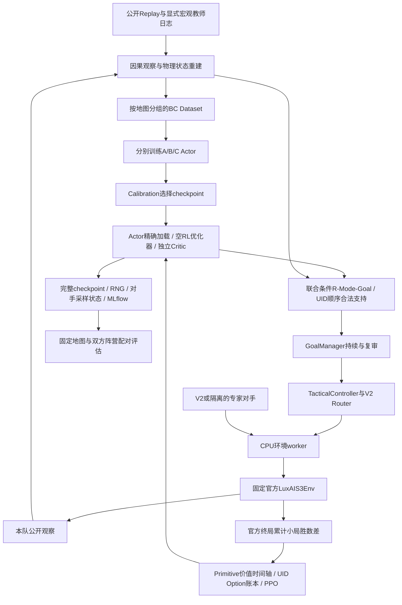

# 环境、架构与学习链路

## 实际调用图

## 作战环境已恢复

官方源码在vendor/lux-design-s3，REVISION和LICENSE一并保留。scripts/official_worker.py使用独立Python/JAX CPU进程；Actor只收到本队合法公开观察、公开配置与官方奖励，不收到隐藏环境状态。

agents/mappo/shared/environment.py负责TeamEnv、primitive推进、真实505步结束与外部短截断的区分。五小局是同一游戏；小局reset保留因果地图事实，死亡/重生和Goal失效由Manager/Option账本分别记录。

GoalManager、TacticalController、物理推断和Router均恢复原实现。神经网络的Goal可能被战术覆盖，因此提议、Manager接收、实际移动和官方收益分别记录。

## 三个模型的真实规模

| 模型 | Actor参数 | 实际实现 | 没有实现/没有证明的部分 |
|---|---:|---|---|
| A | 57220 | 共享CNN空间Actor、物理/路径特征旁路 | 完整多流Cross-Attention高容量战略网络 |
| B | 61956 | A加五小局空间GRU读取 | 完整长期Memory Transformer及其稳定收益 |
| C | 63824 | 单位Attention、UID条件前缀分配 | 完整异步舰队指挥架构或已证实的Goal反事实信用 |

三个模型共享53080参数Critic，原理与实现不能混称。保留它们是为了说明已完成实验与研究局限，不是再次宣称高上限设计已经完整落地。

策略以pi(R|s) pi(Mode|s,R) pi(Goal|s,R,Mode)分解；Continue不产生新Goal，规则强制R不计算虚构的采样分支。逐UID重新计算保留目标，PPO重放同一条件概率与Mask。

## 学习与收益

宏观BC用真实条件标签；primitive辅助只更新空间表征，不绕过部署执行器。RL奖励仍是官方终局累计小局胜数差，不用Goal到达、NLL或效用排序替代。

当前训练框架按primitive时间轴计算价值目标，并单独记录每个UID的Option实例、持续时长和结束原因。存在动作前条件baseline不等于已经识别了Goal的因果贡献；旧PGC实验没有建立该收益信号。

## 冻结B0/FULL参考

baselines/frozen_v5_2包含旧B0策略、学习器、Semi-MDP环境、原控制器和FULL Adapter/Shadow的35文件依赖快照。所有算法文件保持原字节，另有隔离包命名空间。它不加入当前训练默认项。

该快照保留原历史路径守卫，不伪装成所有旧实验的一键Runner。完整冻结Runner与原始实验资产仍在外部归档；当前根目录链路才是可操作的环境/BC/PPO/评估工程。
