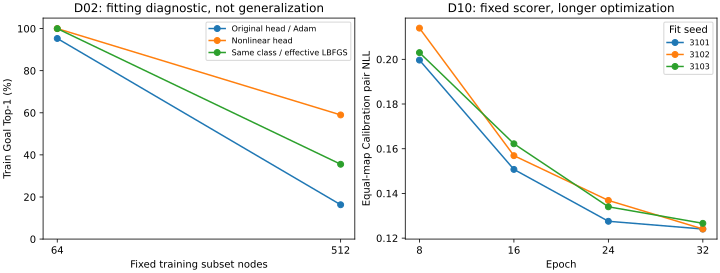
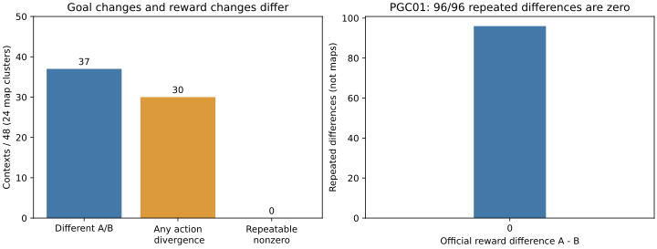

# 给导师讲述这次尝试：两段重点研究

这次项目的价值在于把“智能体输了”逐步拆成可验证的问题：模型是否能表示教师决策、优化是否充分、接口能否执行、干预是否真的影响官方收益。结果没有证明MAPPO超过V2，应如实讲方法、证据和停止决策。

## 建议用约十分钟讲完

### 1. 背景与部署链（两分钟）

Lux S3是部分可观测、多单位协作、五小局共享地图知识的博弈。V2用合法历史记忆、候选效用、联合分配与执行规则；MAPPO使用R/Mode/Goal分层接口。官方指标是累计小局胜数差，不是逐步得分或教师模仿率。

先展示[环境与数据流](architecture_and_environment.md)，再说明G05在固定三个checkpoint上FULL替换优于B0，但这没有证明超过完整V2。由此产生的问题是：为什么学生学不到教师行为？就算学到了，收益会不会改善？

### 2. 板块一：从“拟合差”拆解竞争假设（四分钟）

**假设一：小Head容量不足。** 不能仅靠训练集准确率低就下结论。D02用64/512固定训练节点，比较原6831参数Head、32688参数非线性Head和原函数类的有效系数参数化；另用逐节点LP检查空间可分性。

| D02训练子集 | 原Head / Adam，两个拟合种子均值 | 非线性Head，两个拟合种子均值 | 原函数类有效参数化 / LBFGS |
|---|---:|---:|---:|
| 64节点 | 95.31% | 100.00% | 100.00% |
| 512节点 | 16.31% | 58.98% | 35.55% |

这是记忆/可拟合性诊断，不是地图外评价；LP的每节点自由参数比共享模型宽松。512节点有效参数化仍有非零梯度，不能宣称已经证实其容量极限。D03全量训练的远距离探索Top-1仍只有0.66%，说明小样本记住不等于学到可迁移决策。

**假设二：冻结Encoder缺少信息。** D08比较同为165维的RAW/ENC候选视图。RAW的探索严格候选对准确率约84%–85%，ENC约74%。但RAW仍未达到阳性对照，所以“RAW更好”只能说明当前表征/优化组合的差异，不能唯一归因于Encoder信息损失。

**假设三：只是训练预算不足。** D09确认RAW能够解析重建U_PUBLIC。D10固定数据、Pair、架构和优化器，仅将8轮增加到32轮，三个种子的Calibration均选32轮，部分复杂数学关系得到改善；仍未达到解析对照，也未证明博弈收益。这是一个有正向机制证据、却没有过度晋级的例子。



代码入口：[表示与优化模块](../research/representation_diagnostics/README.md)。来源：D02_results、D08_fit_decision、D10_selection和原D10报告。D07团队上下文未得到可靠增益的结论同样保留。

### 3. 板块二：同状态干预与可复现性（三分钟）

仅看不同轨迹中的Goal与输赢相关性，不能归因。PGC采用公开前缀独立重放，在同一个合法节点为同一UID固定A/B Goal，两个后续采样重复，其他单位根据真实分支继续决策。环境、Actor和对手流区分；Actor用决策身份取随机变量，避免调用次数变化串流。A=B也保留，阴性对照检查逐步一致性。

24地图×2阵营得到48上下文，其中37个A≠B；96个重复对中53个发生动作分叉，但96个终局收益差全部为零，未达到预注册标准。4组同Goal阴性对照的日志逐行一致。研究按规则停止，没有为了制造非零标签挑选地图或重抽Goal。



这里能讲的是“在该采样、时间窗口、一次干预和固定策略下未测到足够信号”，不能讲成“Goal没有价值”或“动作变化没有意义”。Goal通常8步后结束，结束不代表轨迹一定重新收敛。完整正式分支运行器没有搬回主仓库；保留可审阅的小工具、协议和证据。

代码入口：[配对Goal信用模块](../research/paired_goal_credit/README.md)。统计单位为24地图，不能把96重复差或逐步事件当作独立地图样本。

### 4. 研究收获与真实局限（一分钟）

- 可迁移能力：因果信息边界、分层策略接口、确定性回归、RNG隔离、地图分组验证、负结果终止。
- 保留限制：旧400场IL来源不全；探索地图反复使用；三个拟合种子不是三个独立源策略；本次只复算已有证据。
- 没有证明的事：神经策略已学到V2长期战略、任一离线代理改进带来官方收益、三套高上限架构已经完整实现。

若导师问“项目最后成功了吗”，可以回答：**竞争收益目标没有实现；但建立了可执行、可审计的研究流程，并用受控结果排除了多条没有足够证据的路线。**

## 现场演示

```bash
python -B tools/recompute_results.py
python -B -m research.representation_diagnostics.report
python -B -m research.paired_goal_credit.report
python -B -m pytest -q -p no:cacheprovider tests
```

均为离线读取、合成张量或数学测试，不启动环境、训练和新实验。原始证据哈希见reports/evidence/source_index.json；源码抽取来源见research/source_manifest.json。
