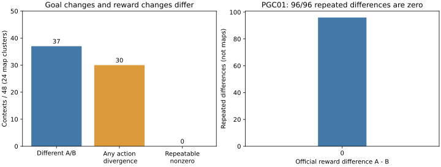

# 板块二：公开前缀、随机流与配对Goal信用

**要回答的问题：** 相同真实前缀下，仅改变一个UID的一次合法Goal，是否能测得跨后续Actor采样重复稳定的终局收益差？保留的是实验方法和负结果，不重新启动这条已关闭路线。

## 设计与实现边界

1. 从同地图/阵营/环境初始化独立执行公开动作前缀，逐记录比较公开观察、输入、支持、意图和记忆指纹；不复制隐藏环境状态。
2. 在首个合格Replan的Goal调用处，固定R、Mode、支持和前序UID提交。A/B从原条件分布各采一次；相同Goal保留，不重抽。
3. 同一重复内A/B使用相同决策身份索引的随机变量，键包含context、repeat、primitive step、UID、head；两个重复的Actor流不同。分叉后，各分支重新决策，不能复制另一分支动作。相同随机变量也不保证环境随机事件逐步配对。
4. 同Goal/同流阴性对照要求逐记录一致。缺失上下文保留在分母，不伪造终局收益。
5. 以地图为簇，共24地图、48上下文、96次重复差；不能当作96张地图。

| 文件 | 当前保留内容 |
|---|---|
| streams.py | 原hash均匀数与逆CDF；固定A/B、继续流、节点证书检查是独立离线适配。 |
| state.py | 原状态摘要函数，保留dtype/shape/类型，拒绝循环和object数组。指纹只用于审计，不能作为Actor输入。 |
| public_replay.py | 原Journal前缀校验；附加公开日志Tape仅能回放原请求，动作改变就拒绝，不能制造反事实未来。 |
| statistics.py | 从完整上下文清单重建符号乘积与整地图Bootstrap，拒绝重复/遗漏。 |
| audit.py | 可选：只读外部归档的提交回执、终局胜数、前缀证书；四组阴性对照解压后逐行字节比较。 |
| report.py | 从仓库内精选证据重建统计和图，无环境、无训练依赖。 |

正式B0采样与环境运行仍以冻结实现为准。这些工具**不是**一个已恢复的正式分支实验Launcher，也不声称在本次整理中重新证明了完整环境因果分支。

## 历史结果

| 口径 | 结果 |
|---|---:|
| 独立地图 / 预选上下文 | 24 / 48 |
| A≠B / A=B上下文 | 37 / 11 |
| 至少一次动作轨迹分叉的上下文 | 30 / 48 |
| 有动作分叉的重复对 | 53 / 96 |
| 两次同向且非零 / 反向 / 含零的上下文 | 0 / 0 / 48 |
| 非零终局收益差 | 0 / 96 |
| Goal持续时间中位数 | 8 primitive steps |
| 192条分支的Goal结束原因 | new_replan 186；goal_invalidated 6 |

动作分叉指已有日志中的轨迹动作差异，不能缩写成“即时动作因果效应”。Goal结束也不能当作两轨迹已经重新收敛。



**VERIFIED：** 当前预注册设计未达到可重复Goal信用标准，原研究路线关闭。**INCONCLUSIVE：** 不能由此推断Goal对收益没有作用，也不能将[0,0]描述区间解释为严格等效或总体无不确定性。

## 协议版本与核验范围

保留的执行协议PGC01实际使用20,000次Bootstrap、seed481903。早先对话要求曾写10,000次；此处公开说明版本差异，照实际冻结协议复算，不改历史参考值。所有差值为零使该差异不改变此次区间，但不能静默抹去。

本次恢复额外只读核验248份回执、192条终局结果，并比较4组阴性对照、共9482条解压日志，结果一致。证据见reports/evidence/PGC01_receipt_audit.json。未完整遍历192条正式分支日志正文或重新模拟环境；全量前缀和Manager行为仍依赖历史工程验收，不能用此次回执核对替代。

如持有外部原始归档，可另指定新文件执行（参数须指向已有PGC01目录，不是保护目录）：

```bash
python -B -m research.paired_goal_credit.audit   --raw-dir /path/to/existing/paired_goal_credit_run_PGC01   --output /tmp/pgc01_receipt_review.json
```

原始轨迹继续留在仓库外，不恢复训练/worker启动入口，不追加样本。
