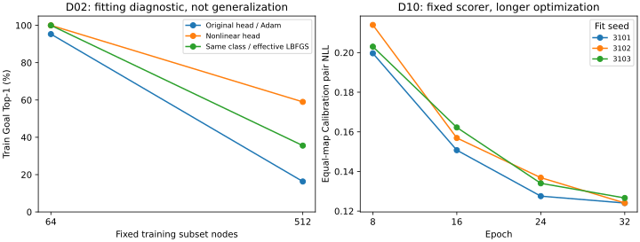

# 板块一：表示能力、优化与泛化的分离诊断

**要回答的问题：** 教师Goal拟合不足，能否直接归因于冻结Encoder丢失信息？本模块保留当时用于拆分假设的最小数学工具及历史证据，不重启模型研发。

## 保留的核心代码

| 文件 | 作用与限制 |
|---|---|
| goal_heads.py | 原6831参数Head、32688参数非线性Head、原函数类的有效系数表示。有效系数形式丢掉与Goal无关的常数，验证的是条件概率一致，不要求原始logits一致。 |
| oracle.py | 给每个节点独立选择空间线性系数的LP可分性诊断。比共享Head宽松，逐节点可分不代表存在一个可泛化的共同解码器。 |
| utility_features.py | D08的RAW/ENC候选描述、U_PUBLIC解析恢复、32个固定Pair槽。与归档原文件字节一致。 |
| ranker.py | 固定165→32→1、5345参数评分器与逐节点等权的硬相对排序损失。 |
| metrics.py | 全候选严格成对准确率、并列最优命中、归一化regret的原定义。 |
| report.py | 从哈希核验后的历史JSON重建小表与图，不执行拟合。 |

RAW与ENC各165维，不意味着信息等价。两者共享单位/Mode/几何/时序变量，但候选格、邻域、单位位置和全图的32维视图分别取原始因果通道或冻结编码。U_PUBLIC可由RAW解析重建，缺失的V2衰减记忆固定为1；它不是U_FULL，也不是长期官方价值。

32个Pair槽固定为16个一般候选对和16个近最优对，使用按节点身份索引的生成器。严格并列没有凭空标签；有效Pair按节点归约，不让大支持集合获得更多样本权重。这里保留采样定义是为了核验旧监督，不据此重新采样或训练。

## 历史证据：该怎样解释

- **VERIFIED：D02**，64固定训练节点上，原函数类有效参数化+LBFGS达到64/64。512节点上仅182/512，且尚有非零梯度。该结果反驳“原Head连极小子集都必然无法表达”的过强说法，但不能宣布512节点已找到全局最优或容量上限。
- **VERIFIED：D02**，512/512节点的独立LP具有正间隔。这是更宽松的逐节点可分性，不是Encoder信息充分性的证明。
- **VERIFIED：D08**，3492节点、24地图按16/4/4分组。三个RAW拟合种子的探索严格成对准确率约84.2%–85.1%，ENC约73.6%–74.0%；RAW也未过阳性对照，不能把差距直接当作Encoder已损坏的证据。
- **VERIFIED：D10**，同一RAW架构与监督增加到32轮，三个种子均按Calibration NLL选择第32轮；距离/抵消切片有改善，仍未达到阳性对照。
- **INCONCLUSIVE：** 当前证据不能唯一分离优化条件、共享函数表达、教师历史信息与跨地图差异；这些离线指标也没有证明官方收益提升。

## 来源与复核边界

结果分别来自D02_R02、D08_E02/F02、D10的冻结JSON，索引见reports/evidence/source_index.json；没有用D02首次失败目录冒充完成结果。D03/D07/D10的既有证据继续保留；不把全部历史D03–D10脚本搬回来。

单测只使用合成张量，检查参数量、零残差嵌套、有效参数化、RAW解析恢复、Pair可重复性、损失归约与LP正/零间隔。不运行优化器，不重新拟合历史节点。原始模型和数据不放进Git。
